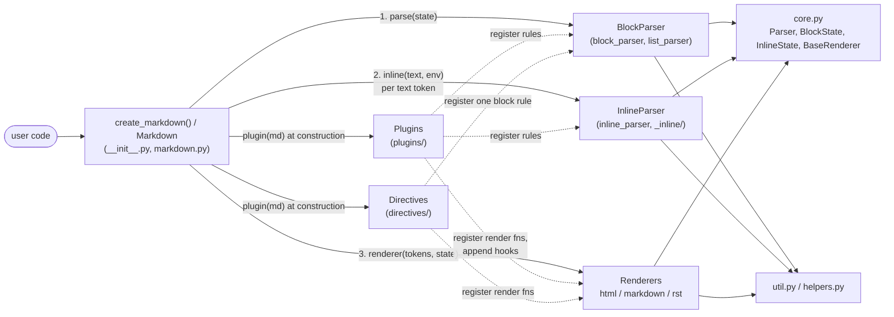

# Mistune: Architecture

Mistune is a fast, pure-Python Markdown parser (CommonMark 0.31.2 compatible) with pluggable
renderers, syntax plugins and directives. This document describes the main components, the key
design decisions behind them, and the rules a developer should not break when changing the code.

---

## 1. Component overview

| # | Component | Files | What it does |
|---|---|---|---|
| 1 | **Public API / orchestrator** | `__init__.py`, `markdown.py` | `create_markdown()` builds a `Markdown` instance from a renderer name or instance and a list of plugins (by name or callable). `Markdown.parse()` runs the pipeline: block parse, then inline parse, then render, with hook lists in between. |
| 2 | **Core abstractions** | `core.py` | `BlockState` / `InlineState` (source, cursor, tokens, a shared `env` dict), the generic `Parser` (named-regex rule registry plus a compiled scanner) and `BaseRenderer` (dispatch by token type). Everything else builds on these. |
| 3 | **Block parser** | `block_parser.py`, `list_parser.py` | Turns the document into block tokens: headings, code, quotes, lists, HTML, reference-link definitions, paragraphs. Leaves inline text unparsed in a `"text"` key. |
| 4 | **Inline parser** | `inline_parser.py`, `_inline/` | Parses inline text into tokens: escapes, code spans, emphasis, links, autolinks, inline HTML, breaks. `_inline/delimiters.py` (`DelimiterScanner`) finds closing markers, and `_inline/emphasis.py` and `_inline/links.py` hold the CommonMark algorithms. |
| 5 | **Renderers** | `renderers/html.py`, `markdown.py`, `rst.py` | Turn the token tree into output. `HTMLRenderer` (`NAME="html"`) also owns output safety (escaping, URL protocol policy). `MarkdownRenderer` (`"markdown"`) and `RSTRenderer` (`"rst"`) convert tokens back to text formats. |
| 6 | **Plugins** | `plugins/` | Optional syntax extensions (table, footnotes, strikethrough, mark, insert, superscript, subscript, math, abbr, def_list, ruby, spoiler, task_lists, url). Each is a callable `plugin(md)` that registers parse rules, render functions and hooks. |
| 7 | **Directives** | `directives/` | A generic block-extension framework. Syntax front-ends (`RSTDirective`, `FencedDirective`) host syntax-independent directive plugins (`Admonition`, `TableOfContents`, `Include`, `Image`, `Figure`). |
| 8 | **Utilities** | `util.py`, `helpers.py`, `toc.py` | Escaping (`escape`, `escape_url`, `safe_entity`), label normalisation (`unikey`), shared regex fragments and link parsing helpers, and TOC hook helpers. |

### Who calls whom



Solid arrows are calls made on every `parse()`. Dotted arrows are registrations that happen once, when
the `Markdown` instance is built.

**Pipeline in order** (`Markdown.parse`, `markdown.py:71-102`): normalise newlines → `before_parse_hooks` →
`BlockParser.parse(state)` → `before_render_hooks` → `render_state()` (this runs the inline parser on each
token that still has `"text"`, then calls the renderer) → `after_render_hooks`. Hooks that run before
rendering therefore see block tokens whose inline text is not parsed yet. With `renderer="ast"` the
renderer is `None` and the token list itself is returned.

**Tokens** are plain dicts: `type` (required; selects the render method), `children`, `text` (unparsed
inline text), `raw` (literal text), and `attrs` (passed to HTML render functions as keyword arguments).
`state.env` is shared by all nested block and inline states of one document. Multi-pass features such as
reference links, footnotes and TOC keep their data there.

---

## 2. Architecture Decision Records

### ADR-1: A token AST is the only interface between parsing and rendering
**Status:** Verified. Evidence: upstream commit `a728952` "fix(plugin): fix footnote plugins when rendering ast";
code comments `__init__.py:49` ("explicit and more similar to 2.x's API", for `renderer="ast"`),
`renderers/html.py:91` ("backward compitable with v2") and `directives/toc.py:88` ("only works with HTML renderer").

* **Context:** Mistune serves several output formats (HTML, Markdown, reStructuredText, raw AST for tooling),
  and third-party plugins must keep working whichever format is chosen.
* **Decision:** Parsers only produce a tree of dict tokens, and renderers only consume it. A renderer is selected
  per instance (`renderer=` in `create_markdown`). `renderer=None` / `"ast"` returns the tree. Each renderer
  declares a `NAME`, and extensions register render functions only for the renderer names they support.
* **Alternatives considered:** (a) parsers emit HTML directly (simplest and fastest, but one format only); (b) a
  typed node-class hierarchy instead of dicts (stricter, but heavier and harder for plugins to extend).
* **Consequences:** New output formats need only a new renderer. Plugin parsing works for every renderer, but
  output support is per renderer, so a token type without a render function raises `AttributeError` at render
  time (`core.py:274-280`). Several plugins and directives (e.g. TOC) are HTML-only. Dict tokens are untyped,
  so token shape is a convention rather than something the type checker enforces.

### ADR-2: Directives separate syntax (front-ends) from semantics (directive plugins)
**Status:** Verified. Evidence: upstream commit `edb9f0c` (2022-10-31) "Refactor directive to support more styles",
which introduced `DirectivePlugin`; follow-ups `1d54bc4` "Update fenced directive to support other markers",
`465040e` "Use directive-type instead of directive-name", `dab16f1` "Rename RstDirective to RSTDirective"
(the deprecated alias is still in `directives/__init__.py:12`).

* **Context:** Users want block extensions (admonitions, TOC, includes, figures) in more than one syntax: the
  reStructuredText style `.. name:: title` and the MyST-like fenced style ```` ```{name} title ````.
* **Decision:** A `BaseDirective` front-end (`RSTDirective`, `FencedDirective`) owns the syntax. It registers
  one block rule and dispatches by directive *type* to handlers. A `DirectivePlugin` owns the meaning and reads
  type, title, options and content only through `self.parse_*` helpers, which delegate to whichever
  front-end's `DirectiveParser` it was attached to (`directives/_base.py:118-121`).
* **Alternatives considered:** (a) one block plugin per directive per syntax (duplicated logic); (b) supporting only
  one syntax.
* **Consequences:** A single directive class works under both syntaxes unchanged, and adding a new syntax means
  writing a new front-end. Unknown directive types render as `block_error` tokens instead of failing
  (`directives/_base.py:91-97`). Directive bodies are parsed as nested block content with the parent's rules,
  bounded by `max_nested_level`.

### ADR-3: Extension by registering named regex rules into an ordered rule list
**Status:** Inferred. Reasoned from `core.py:181-255`. The mechanism is documented in code (the `register` docstring
says it "is usually used to create a new plugin"), but I found no commit or issue that states why this design
was chosen over the alternatives. One related, verified consequence: `plugins/speedup.py:10-15` says the former
speed-up plugin is now a no-op because "the paragraph and inline text fast paths are now part of the core
parsers" (commit `5de41fb`).

* **Context:** The parser must be fast in pure Python and extensible by third parties without forking.
* **Decision:** Each parser keeps `specification` (rule name → regex), an ordered `rules` list and `_methods`.
  `compile_sc()` joins the active rules into one alternation of named groups (cached), and a match is dispatched
  by `m.lastgroup`. Extensions call `register(name, pattern, func, before=...)` on an existing instance; they
  do not subclass the parser.
* **Alternatives considered:** (a) subclassing parsers per feature (does not compose across plugins); (b) a formal
  grammar or PEG parser (cleaner, slower, harder to extend at runtime); (c) a character-by-character
  hand-written state machine (fast, but hard to extend).
* **Consequences:** Plugins compose freely, and priority is controlled by order: earlier alternatives win, so
  `before="link"` etc. matters. If `before` names a rule that is not present, the new rule is appended
  (`core.py:240-248`). A parse function signals "not a match" by returning `None`: the inline parser then
  consumes one character as text (`inline_parser.py:307-312`), and the block parser turns the line into
  paragraph text (`block_parser.py:471-478`).

---

## 3. Constraints (do not break these)

| # | Constraint | Where it can be seen |
|---|---|---|
| C1 | **The core and parser layers must not import renderers, plugins or directives.** `core.py`, `block_parser.py`, `inline_parser.py`, `list_parser.py`, `helpers.py`, `util.py` and `_inline/` only import each other. Only `markdown.py` imports from `plugins` (the `Plugin` protocol, for typing). Extensions depend on the core, never the reverse. | `core.py:1-23`, `block_parser.py:6-18`, `inline_parser.py:6-10`, `markdown.py:3-6` |
| C2 | **Plugins and directives import `Markdown`, the parser classes and renderer classes only under `if TYPE_CHECKING:`.** `markdown.py` imports `plugins`, so a runtime import back would be circular. Runtime imports from plugins and directives are limited to `core`, `util`, `helpers` and sibling modules. | `plugins/formatting.py:5-8`, `plugins/math.py:3-8`, `directives/_base.py:5-8` |
| C3 | **Register render functions only for renderers you support, and guard for "no renderer".** `md.renderer` is `None` in AST mode (`__init__.py:50`), so the pattern is `if md.renderer and md.renderer.NAME == "html": md.renderer.register(...)`. Parse rules are registered unconditionally so the AST is the same for every output format. *Known exception:* `Admonition` instead does `assert md.renderer is not None` (`directives/admonition.py:57`), so it fails with `renderer="ast"`. Do not copy that pattern. | `plugins/formatting.py:111-112`, `directives/toc.py:87-91` |
| C4 | **Directive plugins subclass `DirectivePlugin`, register handlers with `directive.register(type, fn)`, and read syntax only through `self.parse_type / parse_title / parse_options / parse_content / parse_tokens`.** They must not parse RST or fenced syntax themselves or modify a front-end, otherwise they stop working under the other front-end. | `directives/_base.py:124-150`, `directives/admonition.py:25-61` |
| C5 | **Every token type a parser emits must have a render method or a registered render function in each renderer that will see it.** `BaseRenderer._get_method` raises `AttributeError('No renderer ...')` otherwise. HTML render functions receive the rendered children (or `raw`) positionally and `attrs` as keyword arguments, and must escape any text they insert themselves (`util.escape` / `safe_entity`). | `core.py:274-285`, `renderers/html.py:90-107`, `util.py:23-47` |

---

## 4. Conventions and testing

* Parse functions are `parse_<rule>(parser, m, state) -> Optional[int]` (they return the new position) and render
  functions are `render_<token>(renderer, text, **attrs) -> str`. A built-in plugin is exposed by name through the
  `_plugins` registry (`plugins/__init__.py:7`), and a built-in directive is exported from `directives/__init__.py`.
* Code is fully type-hinted and checked with `mypy --strict` over `src/mistune`. Linting is `ruff` (rules `I`, `F`, line
  length 120).
* Tests: `python -m pytest` (`pythonpath = ["src", "."]`, warnings are errors). Most syntax tests are data-driven
  fixtures in `tests/fixtures/*.txt`. Each `example` block holds Markdown input, a line containing only `.`, and the
  expected HTML, loaded through `tests/__init__.py`. Plugin fixtures are run with and without `speedup`
  (`tests/test_plugins.py`).
